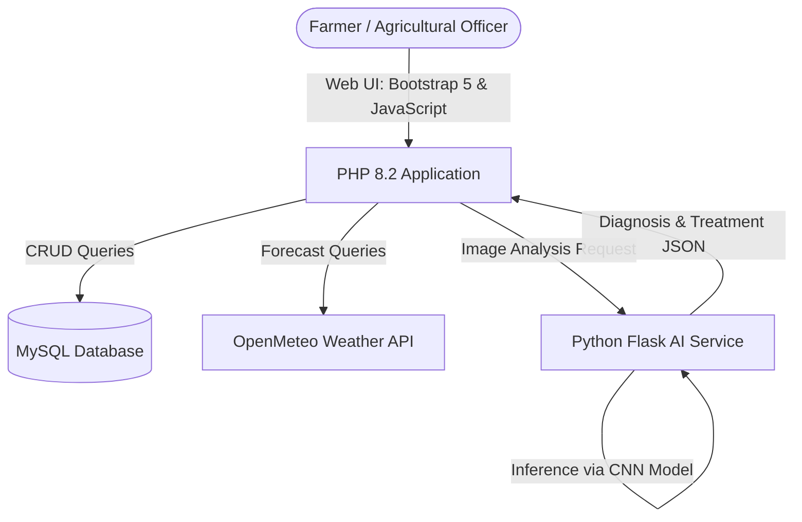

# 🌾 Smart Advisor & Agricultural Intelligence Platform

[](https://www.php.net/)
[](https://www.python.org/)
[](https://www.mysql.com/)
[](https://opensource.org/licenses/MIT)

An enterprise-ready AgriTech web platform and AI microservice designed to empower smallholder and commercial farmers with real-time agronomic insights, computer-vision crop disease diagnosis, localized microclimate alerts, and peer-to-peer marketplace trading.

---

## 🌟 Key Capabilities

### 1. 🤖 AI Plant Doctor (Computer Vision Microservice)
- Python Flask REST service powered by deep learning image classification.
- Farmers upload crop leaf photographs to diagnose plant pathogens, review confidence metrics, and receive actionable chemical and organic treatment regimens.

### 2. 🌦️ Localized Weather & Smart Irrigation Advisories
- Integrated with the **OpenMeteo API** to deliver hyper-local forecasts and rainfall projections.
- Automated advisory engine that cross-references crop growth stages with weather conditions to recommend optimal planting, fertilizing, and spraying windows.

### 3. 🛒 Peer-to-Peer Farmer Marketplace & Community Feed
- Direct commerce portal for buying and selling fresh produce, seeds, equipment, and livestock with built-in WhatsApp and telephone direct contact.
- Interactive community timeline allowing farmers and agricultural extension officers to share best practices, pest outbreak alerts, and local market prices.

### 4. 📊 Farm Financial Accounting & Service Geolocation
- Revenue and expense tracking calculating net farm profitability per crop cycle.
- Interactive **Leaflet.js / OpenStreetMap** mapping agricultural extension offices, agro-dealers, and veterinary clinics.

---

## 🏗️ System Architecture



---

## 💻 Tech Stack
- **Frontend:** HTML5, CSS3, Bootstrap 5, JavaScript (ES6+), Leaflet.js, Chart.js
- **Backend:** PHP 8.2+ (PDO, Object-Oriented Architecture)
- **Database:** MySQL 8.0+ / MariaDB
- **AI Microservice:** Python 3.9+, Flask, TensorFlow / Keras, NumPy, Pillow

---

## 🚀 Quick Start Guide

### 1. Database Setup
1. Open phpMyAdmin or your MySQL CLI.
2. Create a database named `smart_advisor` with collation `utf8mb4_unicode_ci`.
3. Import `database/schema.sql`.

### 2. Web Application Setup
1. Verify database credentials in `config/database.php`.
2. Host on Apache via XAMPP (`http://localhost/smart-advisor`).

### 3. AI Plant Doctor Setup
```bash
cd ai
python -m venv venv

# Windows:
venv\Scripts\activate
# Linux/macOS:
source venv/bin/activate

pip install -r requirements.txt
python app.py
```
*The AI microservice will run on `http://localhost:5000`.*

---

## 🔒 Security & Best Practices
- Prepared statements via PDO protecting against SQL Injection.
- Multi-tier Role-Based Access Control (`Farmer`, `Agricultural Officer`, `Admin`).
- MIME-type validation and server-side sanitization on all uploaded crop photos.

## 📄 License
This project is licensed under the MIT License.
